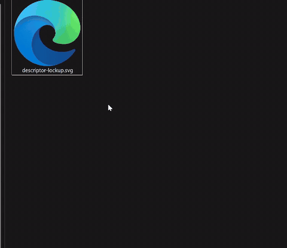
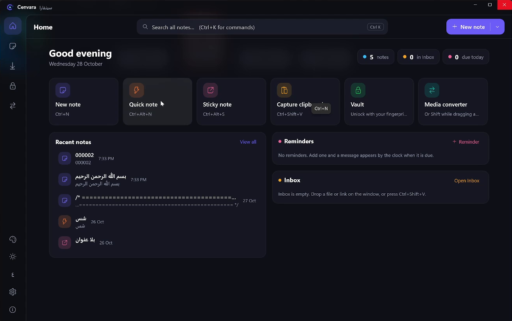
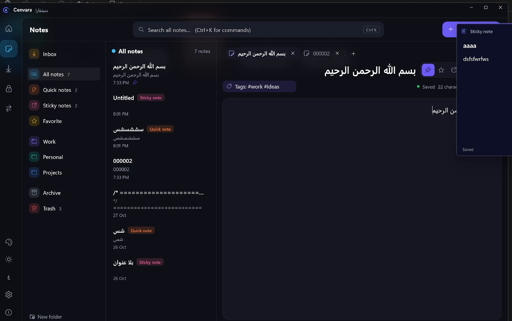
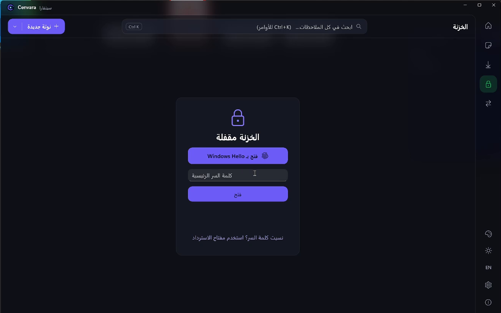
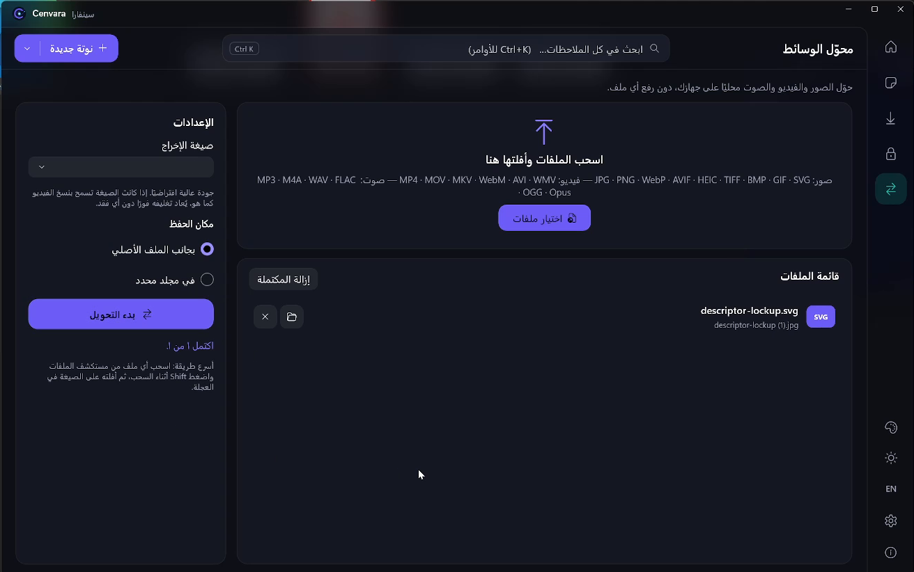

<div align="center">

# Cenvara | سينفارا

**برنامج واحد على ويندوز بدل 3 برامج: نوتة، خزنة آمنة، وتحويل أي ملف بضغطة Shift.**

One Windows app instead of three: notes, a secure vault, and file conversion with a single Shift press.

[**تحميل آخر إصدار / Download the latest release**](../../releases/latest)



</div>

## المميزات

- **عجلة التحويل بـ Shift:** اسحب أي ملف من مستكشف الملفات، اضغط Shift، واختار الصيغة (JPG, PNG, WEBP, AVIF, TIFF, BMP, GIF, PDF). الملف الجديد بيتحط جنب الأصلي.
- **ملاحظات:** ملاحظات عادية ومجلدات وبحث، وملاحظات سريعة، وملاحظات لاصقة بتفضل ظاهرة على سطح المكتب.
- **خزنة آمنة:** بياناتك المهمة متشفرة على جهازك، وبتتفتح ببصمة Windows Hello أو بكلمة السر الرئيسية.
- **محوّل الوسائط:** صور وفيديو وصوت، والتحويل كله بيحصل على جهازك من غير ما ترفع أي ملف.
- **عربي وإنجليزي،** وفيه وضع فاتح ووضع غامق.

| الرئيسية | الملاحظات |
|---|---|
|  |  |
| **الخزنة** | **محوّل الوسائط** |
|  |  |

## التحميل والتشغيل

1. حمّل ملف `Cenvara-*-win-x64.zip` من صفحة [Releases](../../releases/latest).
2. فك الضغط في أي فولدر، مثلًا `Documents\Cenvara`.
3. شغّل `Cenvara.Desktop.exe` من جوه الفولدر. لازم الفولدر كله يفضل مع بعضه، فما تنقلش ملف الـ exe لوحده.
4. البرنامج لسه مش موقّع رقميًا، فممكن تظهرلك رسالة **Windows protected your PC**. اضغط **More info** وبعدين **Run anyway**.

**المتطلبات:** Windows 10 (إصدار 19041 أو أحدث) أو Windows 11، 64-bit. مش محتاج صلاحيات Administrator، ومش محتاج تسطّب .NET.

**تحويل الفيديو والصوت** محتاج FFmpeg. تحويل الصور شغال من غيره. عشان تسطّبه، افتح Terminal واكتب:

```
winget install Gyan.FFmpeg
```

## الخصوصية

كل بياناتك بتتخزن على جهازك في `%LOCALAPPDATA%\Cenvara`. البرنامج مفيهوش حسابات ولا تتبع، ومش بيرفع أي ملفات.

## ملاحظة

ده إصدار تجريبي (Preview)، فممكن تقابل مشاكل. لو لقيت مشكلة أو عندك اقتراح، افتح [Issue](../../issues).

---

Developed by **[Abdelrhman Maghawri](https://abdelrhmanmaghawri.com/)** · © 2026 All rights reserved.
